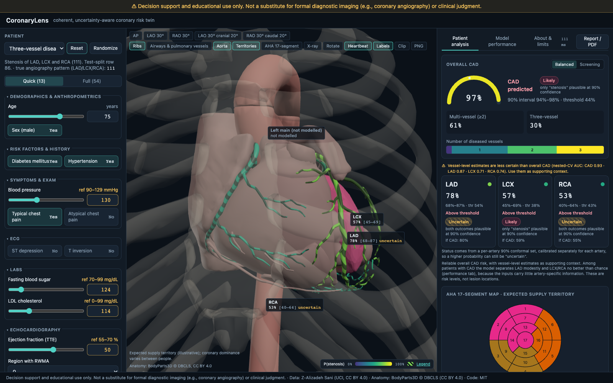
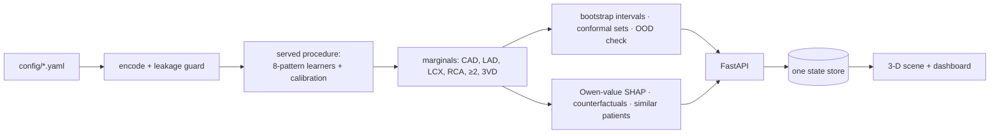

# CoronaryLens

**A coherent, uncertainty-aware coronary risk twin on real anatomy.** Enter a patient's clinical, ECG, lab and echo findings; CoronaryLens estimates the probability of coronary artery disease (CAD) and of stenosis in the LAD, LCX and RCA, colours those arteries on a real 3-D heart, and explains every number. It gives a reliable overall CAD risk, with vessel-level estimates as supporting context.

IIT Mandi Multimodal AI Hackathon 2026 · Track A: Cardiovascular Risk Visualization & Prediction

> **Decision support and educational use only.** Not a substitute for formal diagnostic imaging (e.g., coronary angiography) or clinical judgment. Not a medical device.



## What is different

- **One distribution, so the numbers always fit together.** One calibrated model predicts all 8 LAD/LCX/RCA patterns; CAD, vessel, ≥2- and 3-vessel risks are sums of those. Against a strong ensemble of separate models on identical folds, AUC is equal and risk estimates are significantly better calibrated (log-loss p = 0.0003, Brier p = 0.049); separate models also put P(CAD) below a vessel's risk for 5–32% of patients (for the strong ensemble the gaps were small: mean 0.03, at most 0.18).
- **Validation that counts its own search.** Nested cross-validation with model selection inside every fold; 748 procedures screened; a 61-patient test set held out from the start; a leakage ablation that shows how CAD AUC 0.930 becomes 0.968.
- **Real anatomy.** BodyParts3D meshes; LAD/LCX/RCA mapped by FMA ID; the left ventricle split into the 17 AHA segments, synced with a 2-D bullseye.
- **A clear finding about the data.** The model detects CAD well (nested-CV AUC 0.93), but among patients who have CAD the vessel probabilities separate the diseased artery only modestly for LAD and no better than chance for LCX and RCA (within-CAD AUC LAD 0.69 [0.59–0.78], LCX 0.52 [0.42–0.61], RCA 0.57 [0.47–0.66]; 95% CIs, corrected). Vessel probabilities mostly reflect overall CAD risk because the clinical inputs carry little artery-specific information: the ECG findings are yes/no flags without the leads they appeared in, and wall-motion abnormality is a single code without a documented location.
- **Honest per-vessel explanations.** Owen-value SHAP on the exact displayed output, measurements beside their contributions, conformal "uncertain" shading, intervals and an out-of-distribution warning.

## Results (nested CV of the served model, 10×5 folds, mean [95% corrected CI])

| | CAD | LAD | LCX | RCA |
|---|---|---|---|---|
| ROC-AUC | 0.934 [0.896, 0.973] | 0.866 [0.820, 0.911] | 0.708 [0.647, 0.769] | 0.737 [0.679, 0.796] |
| PR-AUC | 0.972 | 0.894 | 0.578 | 0.583 |
| Brier | 0.089 | 0.144 | 0.204 | 0.194 |
| F1 (max-F1 threshold) | 0.916 | 0.845 | 0.638 | 0.647 |
| Specificity | 0.768 | 0.655 | 0.491 | 0.537 |

Locked test set (n = 61), ROC-AUC: CAD 0.898, LAD 0.829, LCX 0.761, RCA 0.661 (wide CIs; see the report). LCX and RCA are hard to predict from clinical data: after 748 procedures their AUC stayed at about 0.71–0.74. Vessel probabilities mostly reflect overall CAD risk: among patients with CAD, the model picks out LAD disease only modestly and LCX/RCA no better than chance (within-CAD AUC LAD 0.69 [0.59–0.78], LCX 0.52 [0.42–0.61], RCA 0.57 [0.47–0.66]). The app says so above the vessel cards: *"Vessel-level estimates are less certain than overall CAD (nested-CV AUC: CAD 0.93 · LAD 0.87 · LCX 0.71 · RCA 0.74). Use them as supporting context."* Full results, statistics and limitations: **[docs/REPORT.pdf](docs/REPORT.pdf)** (5 pages).

## Quickstart

Prerequisites: Python 3.12 with [uv](https://docs.astral.sh/uv/), Node 22+ (tested on 26), make. Trained models and the 3-D anatomy are committed, so no training or download is needed.

```bash
git clone https://github.com/thseR5/coronarylens.git && cd coronarylens
make setup          # Python + frontend dependencies
make dev            # API on http://localhost:8000, app on http://localhost:5173
```

Or with Docker: `docker compose up --build`, then open http://localhost:8000. A free Hugging Face Space can host the same image: see [deploy/hf-space/DEPLOY.md](deploy/hf-space/DEPLOY.md).

Other commands: `make test` (70 Python + 21 frontend tests), `make test-e2e` (Playwright; run `cd frontend && npx playwright install chromium` once), `make train` (retrain the served model, benchmarks and all artifacts: 470 s on an M2 laptop; the model search itself, `ml/sprint/`, is a separate run of about 25–40 min: screening 4 + 7 min, nested CV 13–30 min), `make anatomy` (rebuild the 3-D model from BodyParts3D), `uv run python tools/build_report.py` (report PDF).

## Using the app

1. Pick a **preset patient** (left) or edit inputs; Quick mode shows 13 key inputs, Full mode all 54.
2. Read the **CAD gauge**, the **vessel cards** and the **3-D heart**: vessel colour = probability of stenosis; moving stripes = uncertain; grey left main = not modelled.
3. **Click a vessel** (in 3-D or on its card) to see why: SHAP waterfall and measurements beside their contributions.
4. **Pin a baseline** and change a value to see what moves; ask for counterfactual suggestions.
5. The **Model performance** tab shows validation, calibration, coherence, decision curves, the model search and what-if checks.

## How it works



- **No leakage:** LAD, LCX, RCA and Cath are rejected as inputs everywhere (tests + HTTP 422); all preprocessing runs inside CV folds.
- **Extensible:** features, targets, anatomy and models are defined in four YAML files; adding a feature or structure needs no code change (tested).
- **Fast:** production build, laptop CPU: slider → probabilities and colours p95 226 ms; → SHAP panel p95 360 ms.

More: [architecture](docs/ARCHITECTURE.md) · [model card](docs/MODEL_CARD.md) · [datasheet](docs/DATASHEET.md) · [TRIPOD+AI checklist](docs/TRIPOD_AI_CHECKLIST.md) · [API](docs/API.md) · [judge Q&A](docs/JUDGE_QA.md) · development history: [decisions](docs/DECISIONS.md), [experiments](docs/EXPERIMENTS.md).

## Extending

- **Add a clinical feature:** add an entry to `config/features.yaml` (column, type, range, group); retrain with `make train`. The input form, API validation and explanations pick it up automatically.
- **Add a model:** add a learner to `ml/sprint/learners.py` and a candidate to `config/models.yaml` → `served_procedure.candidates`; the nested selection decides whether it is served.
- **Add an anatomical structure:** add a node with its FMA IDs to `config/anatomy.yaml`; `make anatomy` rebuilds the glTF; a test checks every target maps to exactly one mesh.

## Limitations

Single-centre data (303 patients, Iran), no external validation, small test set, vessel-level labels only (no lesion location), modest LCX/RCA discrimination and weaker performance in patients aged 65 and over. Territories show typical supply, not the patient's anatomy.

## Data, anatomy and licences

- Data: Alizadehsani R, Roshanzamir M, Sani Z. *Extension of Z-Alizadeh Sani dataset.* UCI Machine Learning Repository, id 411, doi:10.24432/C5461K. CC BY 4.0.
- Anatomy: BodyParts3D, © The Database Center for Life Science, CC BY 4.0 (details and FMA IDs in `frontend/src/three/LICENSES.md`).
- Code: MIT (see [`LICENSE`](LICENSE)). The MIT licence covers our code only; the dataset and anatomy keep their CC BY 4.0 licences. Summary: [`LICENSES.md`](LICENSES.md).
