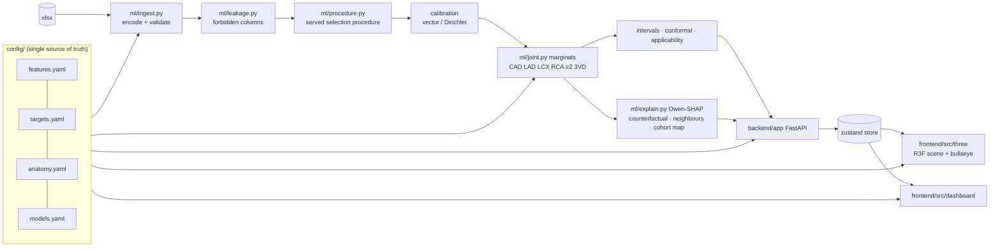

# Architecture

## Principles

1. **Coherent by construction.** The model predicts a distribution over the 8 LAD/LCX/RCA patterns; every displayed number is a marginal of it (`ml/joint.py`). P(CAD) = 1 − P(000) ≥ every vessel probability (tested).
2. **One source of truth.** Features, targets, anatomy and models live in four YAML files that the pipeline, API (`GET /api/config`) and frontend all read. The frontend bundles the same YAML as an offline fallback.
3. **Explanations explain what is shown.** SHAP runs on the full served function (encoding → learners → calibration → marginalisation), not on an internal model.
4. **One state store.** The 3D scene and dashboard read the same zustand store (`frontend/src/store`), so they cannot disagree. The 3D view writes only selection and hover.

## Backend

| Path | Purpose |
|---|---|
| `ml/ingest.py`, `ml/leakage.py` | Encoding, validation, forbidden-column guard (train, evaluation, inference) |
| `ml/procedure.py` | Served model: inner selection over finalists, chosen learners, calibrator, bootstrap ensemble |
| `ml/sprint/` | Model search: learners, screening, nested CV, finalist rule, corrected statistics |
| `ml/train.py` | Benchmarks, final fit, test evaluation, conformal, DCA, explanations, artifacts |
| `ml/predictor.py` | Loads artifacts; analyze / explain / counterfactual / similar / cohort map |
| `ml/fastsvm.py` | Exact vectorised libsvm probabilities (serving speed) |
| `backend/app/main.py` | FastAPI endpoints (`docs/API.md`); serves the built frontend in production |
| `backend/app/service.py` | LRU cache; explain/counterfactual in a separate worker process; per-tab cancellation; explain prefetch on analyze |

**Latency design.** `/analyze` runs in the main process. Explanations run in a spawned worker with its own model copy, so they never hold the GIL during `/analyze`. Each browser tab sends `X-Client-Id`; a newer request cancels that tab's queued jobs (HTTP 409, treated as an abort). `/analyze` starts the explanation early so `/explain` usually joins a running job. Measured on the production build: colours p95 175 ms, SHAP panel p95 241 ms.

## Frontend

| Path | Purpose |
|---|---|
| `src/three/` | R3F scene: glTF from BodyParts3D, vessel colouring, uncertainty stripes, AHA segments, labels, camera presets, clipping, heartbeat, low-power mode |
| `src/three/aha.ts`, `Bullseye.tsx` | One segment → vessel table for the 3D segments and the 2D bullseye |
| `src/dashboard/` | Inputs, risk summary, vessel cards, SHAP waterfall, measurements, what-if, similar patients, cohort map, performance tab |
| `src/dashboard/useLiveAnalysis.ts` | Debounce 100 ms → `/analyze` → paint → `/explain` (startTransition); aborts stale requests; performance marks |

## Anatomy pipeline

`tools/build_anatomy.py`: BodyParts3D 4.0 part-of tree → resolve FMA concepts to element OBJs → merge, decimate, one common transform (+X patient left, +Y superior, +Z anterior) → AHA segments of the LV surface (`tools/territory_check.py::aha_segments`) → glTF with meshopt compression (`frontend/public/models/anatomy.glb`, 0.45 MB) + manifest + licence file.

## Extending

- **Feature:** add it to `features.yaml` and retrain. The API schema, input form and explanations update automatically (`ml/tests` include a config-extensibility test).
- **Model:** add a learner to `ml/sprint/learners*.py` and a candidate to `models.yaml → served_procedure.candidates`. Nested selection decides whether it is served.
- **Anatomical structure / vessel:** add a node with FMA IDs to `anatomy.yaml` and rebuild. A test asserts every target maps to exactly one vessel mesh. Adding a vessel target grows the pattern space to 2^k (the joint model handles k ≤ 4 directly; beyond that a chain-based joint model would replace the full powerset).

## Testing and CI

`make test`: 70 Python tests covering leakage, determinism, coherence, calibration, conformal coverage, SHAP additivity, exactness of the Owen deduplication, FastSVC equivalence, corrected statistics, API contract, isolation and latency, cohort map, and territories. 21 frontend tests cover the 3D ↔ bullseye mapping, hover sync, colour scale, anatomy manifest and dashboard. `make test-e2e` runs Playwright for the full stack (preset, 3D hover, clipping, cohort map, report, model tab), the 3D scene and FPS, and latency on the production build. GitHub Actions (`.github/workflows/ci.yml`) runs lint, type checks, tests and the build.
