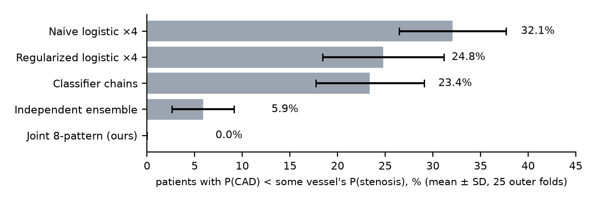
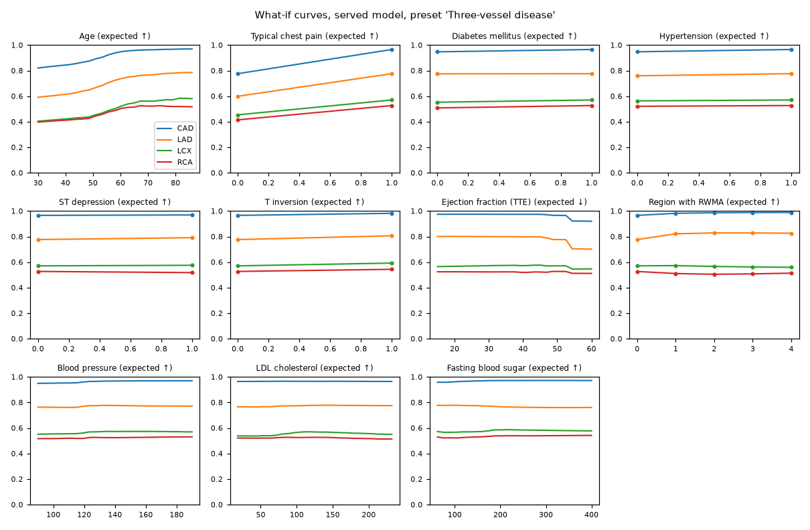
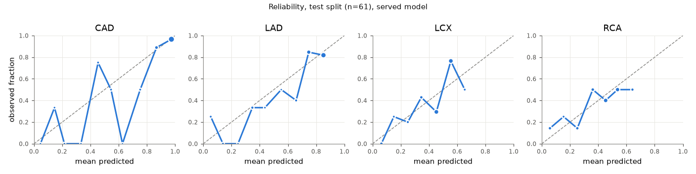

# CoronaryLens: a coherent, uncertainty-aware coronary risk twin on real anatomy

IIT Mandi Multimodal AI Hackathon 2026 · Track A: Cardiovascular Risk Visualization & Prediction

> **Decision support and educational use only.** Not a substitute for formal diagnostic imaging (e.g., coronary angiography) or clinical judgment.

## Summary: four results

1. **One coherent model for CAD and all three vessels.** Every displayed probability is a marginal of one calibrated distribution over the 8 possible LAD/LCX/RCA stenosis patterns, so CAD, vessel, ≥2-vessel and 3-vessel risks always fit together. Separate per-target models contradict themselves (P(CAD) below a vessel's risk) for 32.1% of patients (naive logistic regression) and 5.4% (a strong LR + RF + ExtraTrees ensemble); ours for 0%. These contradictions are small (mean gap 0.03) and a post-hoc patch can hide them, so the main gain is elsewhere: on identical folds our model matches the ensemble's AUC (no significant difference for any target) and gives significantly better risk estimates (pattern log-loss 1.508 vs 1.662, p = 0.0003; mean Brier 0.158 vs 0.166, p = 0.049; Nadeau–Bengio corrected tests).
2. **Validation that accounts for its own search.** Repeated nested cross-validation (CV) on a 242-patient training split; 748 modelling procedures screened; model selection inside every outer fold; a 61-patient test split held out from the start. A leakage ablation shows how oversampling and feature selection on the full dataset inflate results (CAD AUC 0.930 → 0.968). We also report plainly what the data cannot do: it tells *whether* coronary disease is present far better than *which* artery is affected.
3. **Real anatomy.** BodyParts3D meshes (CC BY 4.0) with LAD, LCX and RCA mapped to model outputs by FMA identifiers, and the left ventricle split into the 17 AHA segments, coloured and hover-synced with a 2-D bullseye.
4. **Explanations and uncertainty per vessel.** Owen-value SHAP on the exact displayed output, measurements beside their contributions, conformal "uncertain" shading on vessels, bootstrap intervals and an out-of-distribution warning.


## 1. Data and preprocessing

**Dataset.** Extension of Z-Alizadeh Sani (UCI id 411, CC BY 4.0, DOI 10.24432/C5461K): 303 patients, 59 columns, no missing values. Targets: `Cath` (CAD, 216/303), LAD (177), LCX (119), RCA (114) stenosis. There is no separate CAD column: `Cath` is the CAD label. The dataset has no cardiac enzymes, total cholesterol, diastolic pressure or left-main label; we do not invent them.

**Label structure.** CAD equals "any vessel stenotic" for 302/303 patients (one patient: `Cath` = Normal with LAD stenotic; `Cath` stays the CAD ground truth). The 8 vessel patterns range from 86 patients (no stenosis) to 10 (LCX + RCA); pairwise vessel correlations are 0.28–0.39.

**Encoding.** 54 input features (constant `Exertional CP` dropped) → 55 model columns: Y/N and `Male`/`Fmale` to 0/1, ordinal VHD and functional class, one-hot bundle-branch block. Engineered features (eGFR, lipid ratios, NLR, risk-factor and ECG counts) were tested inside nested CV and not kept (Δ log-loss −0.0005 ± 0.0046).

**Leakage control.** LAD, LCX, RCA and `Cath` are forbidden as inputs; a guard raises an error in training, evaluation and inference, and the API rejects them (HTTP 422). Every preprocessing, selection, calibration and threshold step runs inside CV folds. No feature had a within-fold univariate AUC above 0.95 for any target. No SMOTE.

## 2. Model

**Joint 8-pattern model.** Instead of four separate classifiers, one model predicts P(pattern) for the 8 LAD/LCX/RCA combinations. All outputs are sums of these: P(vessel) = Σ patterns containing it; **P(CAD) = 1 − P(no stenosis)**; P(≥2 vessels); P(3-vessel disease). P(CAD) ≥ every vessel probability holds by construction and is asserted in tests.

**Served procedure.** The served model is a validated *selection procedure*, not a hand-picked learner. On the training split it builds inner 5-fold out-of-fold predictions for 10 finalist pipelines (8-class learners such as CatBoost, an RBF SVM, in-fold-selected elastic-net and Bayesian logistic regression, EBM; averaged; vector or Dirichlet calibration), scores each with cross-fitted calibration, and serves the best. On the full training split it selects **CatBoost + CatBoost (depth 3) + SVM, averaged, vector-calibrated**, by a margin of only 0.0004 in inner log-loss over an EBM + Bayesian-LR + selection pipeline; across the 50 outer folds the inner choice varied (that EBM pipeline 28×, this one 3×), which is why the headline describes the selection procedure rather than one pipeline. Operating thresholds (max-F1 and a screening mode with sensitivity ≥ 0.90) come from out-of-fold predictions.

**Model search (details in `docs/EXPERIMENTS.md`).** 748 procedures were screened with repeated CV on the training split only (learners, calibrations, learned ensemble weights, a vessel-count blend, a clinically informed prior, in-fold feature selection, per-target stacking, SVM). Ten finalists, chosen by a rule written down before the second screening round's results were read (committed together with them), went through 10×5 nested CV with selection inside every outer fold. TabPFN was considered and not used (license-gated weights; CPU inference cost incompatible with live explanations).

## 3. Validation and results

**Protocol.** A stratified 80/20 split (on the 8 patterns) locks 61 test patients away. The primary estimate is nested CV of the whole selection procedure on the 242 training patients (10 repeats × 5 outer folds; inner 5-fold OOF; cross-fitted calibration). Because repeated-CV folds overlap, all CIs and paired tests use the Nadeau–Bengio correction (variance factor 1/J + n_test/n_train, J = 50).

**Table 1. Served procedure, nested CV (mean [95% corrected CI]).** Threshold metrics at the max-F1 threshold chosen inside each training fold.

| Target | ROC-AUC | PR-AUC | Brier | Accuracy (majority) | Precision | Recall | Specificity | F1 |
|---|---|---|---|---|---|---|---|---|
| CAD | 0.934 [0.896, 0.973] | 0.972 | 0.089 | 0.880 (0.711) | 0.909 | 0.926 | 0.768 | 0.916 |
| LAD | 0.866 [0.820, 0.911] | 0.894 | 0.144 | 0.805 (0.583) | 0.789 | 0.913 | 0.655 | 0.845 |
| LCX | 0.708 [0.647, 0.769] | 0.578 | 0.204 | 0.630 (0.612) | 0.515 | 0.848 | 0.491 | 0.638 |
| RCA | 0.737 [0.679, 0.796] | 0.583 | 0.194 | 0.654 (0.624) | 0.527 | 0.848 | 0.537 | 0.647 |
| ≥ 2 vessels | 0.766 [0.711, 0.820] | | | | | | | |
| 3 vessels | 0.755 [0.689, 0.821] | | | | | | | |

"Majority" = accuracy of always predicting the more common class. The max-F1 thresholds favour sensitivity, so LCX/RCA accuracy is only slightly above that baseline.

**Table 2. Coherence and discrimination of alternative designs** (nested CV; rows 1–4 on the same 5×5 benchmark folds; served row on the 10×5 folds, compared with the ensemble on identical folds).

| Design | CAD | LAD | LCX | RCA | 8-pattern log-loss | Contradictions |
|---|---|---|---|---|---|---|
| Naive logistic regression ×4 (L2, C = 1) | 0.897 | 0.800 | 0.626 | 0.706 | 2.432 | 32.1% |
| Classifier chains | 0.914 | 0.834 | 0.655 | 0.724 | 1.843 | 23.4% |
| Independent LR+RF+ET ensemble | 0.924 | 0.854 | 0.707 | 0.742 | 1.663 | 5.9% |
| Joint 8-pattern LR+RF+ET (first served model) | 0.923 | 0.850 | 0.711 | 0.740 | 1.578 | 0% |
| **Served procedure** (10×5 folds) | 0.934 | 0.866 | 0.708 | 0.737 | 1.508 | **0%** |
| Independent ensemble on the same 10×5 folds | 0.926 | 0.855 | 0.706 | 0.742 | 1.662 | 5.4% |

Four elastic-net logistic regressions (C = 0.3) on the benchmark folds still contradict themselves for 24.8% of patients, so the effect is not caused by weak regularisation. Served vs independent ensemble, paired over 50 identical folds: log-loss −0.153 (t = −3.93, p = 0.0003, better in 49/50 folds), Brier −0.008 (p = 0.049), AUC differences +0.008 / +0.011 / +0.002 / −0.005 (all p > 0.2).



**What the model search bought.** Against the first served model on identical folds, only the risk estimate improved significantly (pattern log-loss −0.067, p = 0.002, 46/50 folds). The Brier gain (−0.004) and the CAD/LAD AUC gains (+0.007, +0.015) are small and not statistically significant; LCX and RCA did not improve. We tried 748 procedures and the LCX/RCA ceiling held: with clinical data alone, the circumflex and right coronary arteries stay at AUC ≈ 0.71–0.74.

**Where the model fails: which artery.** Vessel probabilities mostly carry overall CAD risk. Among patients who have CAD, they separate the diseased artery only modestly for LAD (within-CAD AUC 0.686) and barely better than chance for LCX (0.515) and RCA (0.566) (nested-CV outer predictions). In single-vessel LCX or RCA patients the true artery was never the highest-probability vessel (0/100 and 0/140 fold-instances; LAD-only: 458/460). Dedicated models trained only on CAD patients reached at most 0.62 for LCX in exploratory CV (best of three, optimistic). Exploratory models: `reports/sprint/within_cad_dedicated.json`. The UI states this above the vessel cards ("Vessel-level estimates are less certain than overall CAD (nested-CV AUC: CAD 0.93 · LAD 0.87 · LCX 0.71 · RCA 0.74). Use them as supporting context."), next to every vessel explanation and in exported reports, and the territories/bullseye show which artery usually supplies a region, not risk.

**Locked test set (n = 61; 44 CAD).** ROC-AUC with 95% bootstrap CIs: CAD 0.898 [0.80, 0.97], LAD 0.829 [0.71, 0.93], LCX 0.761 [0.64, 0.87], RCA 0.661 [0.51, 0.80]; specificity 0.53 / 0.60 / 0.50 / 0.53. The independent ensemble on the same patients: 0.917 / 0.820 / 0.716 / 0.713 (DeLong p ≥ 0.17 for every target) with 0% contradictions on this small set. The test set was looked at twice: before the search (first model: 0.920 / 0.842 / 0.692 / 0.685) and after it (above). All differences lie inside the CIs; nothing was selected or tuned on these patients, and nested CV is the primary estimate.

**Leakage ablation (analysis only, never served).** Random forest, 10-fold × 3: running SMOTE and top-20 feature selection on the full dataset before CV gives CAD AUC 0.968, LCX 0.842 and RCA 0.851; doing both inside each fold gives 0.930, 0.714 and 0.715. Selection before CV alone gives 0.931 / 0.741 / 0.726. SMOTE before CV causes most of the inflation; this is why we report ~0.93, not 0.97–0.99.

**Comparison with published work on this dataset** (different protocols; not a like-for-like ranking). Accuracy LAD / LCX / RCA: Alizadehsani et al. 2012 (decision tree, 10-fold) 74.2 / 63.8 / 68.3%; 2013 (bagging) 79.5 / 65.1 / 68.0%; 2020 (SVM with feature selection, 10-fold) 86.6 / 83.5 / 82.9%. Ours (nested CV, threshold chosen for F1, not accuracy): 80.5 / 63.0 / 65.4%. A 2025 study reports 97.7% CAD accuracy (feature selection before cross-validation, SMOTE inside it); in our ablation, selection before CV alone changes CAD AUC only from 0.925 to 0.931, so we do not attribute that result to leakage.

**Subgroups (nested CV).** Performance is lowest in patients aged ≥ 65 (n = 76: CAD 0.840, LCX 0.539, RCA 0.588) compared with < 50 (n = 47: CAD 0.911) and 50–64 (n = 119: CAD 0.949). Women (n = 104) CAD 0.960; men (n = 138) 0.905.

## 4. Calibration, uncertainty, decision value

- **Calibration** (test): slope / ECE CAD 0.95 / 0.088, LAD 1.03 / 0.092, LCX 1.34 / 0.140, RCA 0.67 / 0.082.
- **Conformal prediction** (class-conditional, 90% target): test coverage CAD 0.87, LAD 0.84, LCX 0.92, RCA 0.87. The UI shows *likely*/*unlikely* only when the 90% set is a single outcome that agrees with the threshold decision; otherwise *uncertain* (moving stripes), and always *uncertain* for out-of-distribution patients or when missing inputs carry ≥ 25% of the model's usual signal (each missing input weighted by its global mean |SHAP| for CAD); colours fade gradually as more signal is missing. Each status shows its reason inline. Displayed as uncertain on the (complete) test set: 18% of test patients for CAD, 26% LAD, 54% LCX, 52% RCA.
- **Thresholds**: max-F1 ("Balanced") and a "Screening" threshold (sensitivity ≥ 0.90, never above the max-F1 threshold), both from out-of-fold predictions.
- **Intervals**: 50 bootstrap refits of the served learners with the served hyperparameters; 5th–95th percentile spread centred on the served estimate (the raw percentile interval already contained it for 95–100% of test patients); mean width CAD 0.18 to LCX 0.27.
- **Applicability domain**: Mahalanobis distance (Ledoit–Wolf) with a 99th-percentile threshold; inputs beyond it trigger an "outside training distribution" warning.
- **Decision curves** (test, CAD): net benefit 0.541 vs 0.443 for treat-all at a 0.5 threshold.

## 5. Explanations

Explanations are computed on the exact function that is displayed: input encoding → served procedure → calibration → marginalisation, for five outputs at once (CAD, LAD, LCX, RCA, ≥ 2 vessels). We use Owen values (SHAP with a two-level hierarchy: six clinical groups, then features), estimated with antithetic hierarchy-respecting permutations against 50 real training patients. Base value + contributions equals the displayed probability exactly (additivity error 0.0). Fidelity: removing the top-ranked features changes P(CAD) more than removing random ones (deletion-curve area 0.217 vs 0.051). Stability: across 8 permutation seeds, no contribution varies by more than about 0.025 (largest SD 0.0251) and top-5 features overlap by ≥ 85%. Rankings agree only partly with permutation importance (Spearman ρ −0.01 to 0.46), a known difference between local attributions and global importance on correlated clinical data. The dashboard shows a waterfall per vessel, group totals, every measurement beside its contribution and deterministic plain-language sentences (clinician and patient wording; no generated text). Strongest global drivers of P(CAD): typical chest pain, age, ejection fraction, regional wall-motion abnormality, atypical pain, T inversion.

**What-if check.** Sweeping 11 key features across their training range for 5 preset patients, P(CAD) never moved against the clinically expected direction (tolerance 0.02), and no single grid step of a numeric feature changed a probability by more than 0.15 (binary features such as typical chest pain move P(CAD) by up to 0.30, as expected). Six small vessel-level reversals (≤ 0.048) remain, mostly regional wall-motion score → LCX/RCA.

## 6. 3D pipeline

`tools/build_anatomy.py` downloads BodyParts3D 4.0 (part-of tree), resolves FMA concepts to element meshes (25 IDs, none missing), merges, decimates and exports one meshopt-compressed glTF (0.45 MB, 91,777 triangles) with named nodes: LAD, LCX, RCA, left main (grey: not modelled), myocardium, aorta, ribs, sternum, airways. Vessel colours follow P(stenosis) on a colour-blind-safe viridis scale with 3-D labels showing probability and interval.

**Territories.** The LV surface is split into the 17 AHA segments (rings along the principal long axis; sectors oriented by the right ventricle; apex cap) and each segment is coloured by the artery that usually supplies it under the standard assignment (Cerqueira et al., 2002; a fixed colour per artery, not risk, because the model has no regional information), the same table that drives the 2-D bullseye; a test asserts the two agree, and hovering a segment highlights it in both. An optional nearest-artery estimate is shown for comparison; it was adjusted toward the AHA convention during development, so its agreement (14/17 segments) is alignment, not independent validation. Both are labelled as expected supply territory, illustrative, varying with coronary dominance.

## 7. System and performance

FastAPI serves `/analyze`, `/explain`, counterfactuals, similar patients, cohort map and a printable report; React + React Three Fiber renders the scene and dashboard from one shared state store, so 3D and panels never disagree. All features, targets, anatomy and models are defined in four YAML files; adding a feature, model or structure needs no code redesign (tested). Explanations run in a separate worker process so they never block `/analyze`; an exact vectorised re-implementation of libsvm probabilities makes SVM prediction 4.4× faster. Measured on the production build (M2 laptop, 40 edits): slider → probabilities and vessel colours p95 **226 ms**; slider → SHAP panel p95 **360 ms**. 3D (5 s auto-rotate with heartbeat, 1440×900): 60 FPS with the GPU; 46–60 FPS in two runs with the GPU disabled (SwiftShader software rendering, low-power mode, idle machine).

## 8. Limitations and ethics

Single-centre cohort (n = 303, Iran) with no external validation; small test set; vessel-level labels only (no lesion location); LCX/RCA discrimination is modest and the oldest subgroup is weakest; territories are typical, not patient-specific; the cohort map uses 2-D PCA (13% of variance). Not a medical device: the disclaimer is shown in the UI banner, footer and every exported report. Counterfactuals are labelled "model sensitivity, not treatment advice". Data and anatomy are used under CC BY 4.0 with attribution. Reporting follows TRIPOD+AI (checklist in `docs/TRIPOD_AI_CHECKLIST.md`).

## 9. Usage

```
make setup && make dev      # API :8000 + web :5173   (or: docker compose up → http://localhost:8000)
make test                   # 70 Python + 21 frontend tests;  make train / make anatomy rebuild everything
```

**Appendix: further features (one line each).** Cohort map of training patients (PCA) with click-to-load · nearest training patients with their true angiography · counterfactual suggestions on modifiable factors · frontal clipping plane · X-ray view · angiographic camera presets (AP, LAO/RAO, cranial/caudal) · heartbeat at the patient's pulse · printable report / PDF · decision curves, reliability plots, subgroup table and model search in the performance tab · classifier-chain and LightGBM benchmarks · Docker image and CI. Development history: `docs/DECISIONS.md`, `docs/EXPERIMENTS.md`.

**Appendix figures.**



*What-if curves of the served model for the "three-vessel disease" preset: each panel sweeps one feature across its training range with the other inputs fixed; P(CAD) never moves against the clinically expected direction (all 5 presets: `reports/whatif/`). The step in ejection fraction near 55% is a tree split at the reference-range boundary.*



*Reliability on the locked test set (n = 61), served model.*

**References.** Alizadehsani R, Roshanzamir M, Sani Z. Extension of Z-Alizadeh Sani dataset. UCI ML Repository, doi:10.24432/C5461K. · Alizadehsani R et al. Hybrid genetic-discretized algorithm to handle data uncertainty in diagnosing stenosis of coronary arteries. *Expert Systems* 2020, doi:10.1111/exsy.12573. · Baratpur AZ et al. Coronary artery disease prediction using Bayesian-optimized SVM with feature selection. *Front Netw Physiol* 2025, doi:10.3389/fnetp.2025.1658470. · Mitsuhashi N et al. BodyParts3D. *Nucleic Acids Res* 2009. · Cerqueira MD et al. Standardized myocardial segmentation. *Circulation* 2002. · Nadeau C, Bengio Y. Inference for the generalization error. *Machine Learning* 2003. · Kull M et al. Beyond temperature scaling: Dirichlet calibration. NeurIPS 2019. · Lundberg SM, Lee S-I. A unified approach to interpreting model predictions. NeurIPS 2017. · Vickers AJ, Elkin EB. Decision curve analysis. *Med Decis Making* 2006. · Collins GS et al. TRIPOD+AI. *BMJ* 2024;385:e078378.
